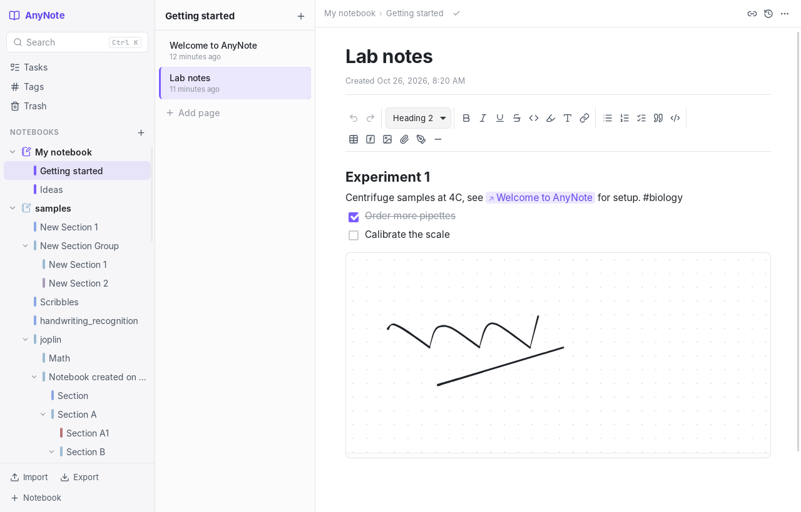
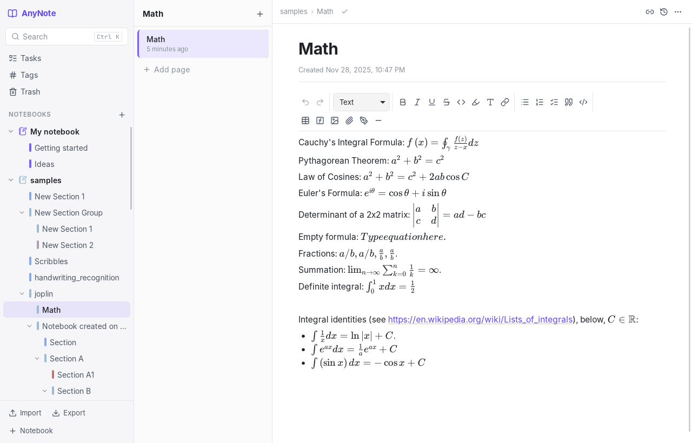

# AnyNote

A local-first notebook app for Linux, in the spirit of OneNote but with an open format. It has notebooks, sections and pages, rich text, handwriting, tasks, math and code. Everything stays on your machine in files you can read without the app, and it imports your OneNote notebooks.



## Why another notebook?

AnyNote follows the build plan in [docs/PLAN.md](docs/PLAN.md). It keeps OneNote's good idea, an object graph with history, and replaces the parts that hurt:

| OneNote | AnyNote |
| --- | --- |
| Proprietary binary `.one` files; exports lose layout and ink | Open folder format: Markdown for people and git, plus a lossless JSON sidecar ([FORMAT.md](docs/FORMAT.md)) |
| Sync delays and "conflict pages" | Every page is a CRDT document (Yjs), so concurrent edits merge instead of conflicting. Works fully offline. |
| No Markdown, weak code support | Markdown shortcuts, syntax-highlighted code blocks, LaTeX math (KaTeX) |
| Weak linking between pages | `[[wiki links]]` stored by page id, so renames never break them; backlinks panel |
| Tags are flat; to-dos are hard to find | `#tags` anywhere in the text, a tag browser, and one Tasks view across every notebook (tick tasks there and the page updates) |
| Free canvas leaves stray text boxes | Canvas pages tidy away empty boxes and export in reading order; document pages are there when you want a plain flow |
| API can't read ink | Ink is plain vector data in the page document, and is exported as SVG |

### Features

- Notebooks with colour coding, nested sections (section groups), and pages with subpages
- Rich text with headings, lists, to-dos, quotes, tables, links, highlight and text colour, sub/superscript
- Code blocks with syntax highlighting, and inline and display math
- Canvas pages: write, draw and type anywhere on an open page, with pinch and Ctrl+wheel zoom. Text goes into boxes you can drag and resize.
- Pen (pressure-sensitive), highlighter and stroke eraser, saved as vector strokes, on canvas pages or as drawing blocks in document pages
- Images and file attachments (paste or drag & drop). Audio and video play inline.
- `/` slash menu for any block, and `[[` to link or create a page
- Full-text search (Ctrl+K) with highlighted snippets
- Tasks view, Tags view, backlinks, and version history with preview and restore
- Trash with restore
- **Import:**
  - OneNote `.one` sections, `.onetoc2` notebooks and `.onepkg` packages, including handwriting, equations (converted to LaTeX), tables, images, attachments and to-do tags
  - Markdown folders such as Obsidian vaults and AnyNote exports
- **Export:** Markdown + JSON sidecars + assets, per notebook or everything



The table at the top of [`crates/anynote-onenote/src/lib.rs`](crates/anynote-onenote/src/lib.rs) shows how each OneNote structure maps to AnyNote. [ROADMAP.md](docs/ROADMAP.md) lists what doesn't come across yet.

## Install

Release builds (`.deb`, `.rpm`, `.AppImage`) are produced by the [release workflow](.github/workflows/release.yml) when a version tag is pushed. To build them yourself, follow [Build from source](#build-from-source) and run `npx tauri build` in `app/`. The packages land in `target/release/bundle/`.

## Raspberry Pi and older Linux (browser version)

The desktop app needs WebKitGTK 4.1, which older systems such as Raspbian 11 (bullseye) don't have. `anynote-server` is the same app as one static program: it serves the interface, which is built into it, opens it in Chromium as an app window, and keeps notes in the same data folder. It needs nothing installed and no internet.

Build it for a 32-bit Pi (`armv7l`) from any Linux PC:

```sh
cd app && npm install && npx vite build && cd ..
pip install ziglang && cargo install cargo-zigbuild
rustup target add armv7-unknown-linux-musleabihf      # aarch64-unknown-linux-musl for 64-bit Pi OS
cargo zigbuild --release -p anynote-server --target armv7-unknown-linux-musleabihf
# → target/armv7-unknown-linux-musleabihf/release/anynote-server
```

Copy the file to the Pi (a USB stick is fine), make it executable (`chmod +x anynote-server`) and run it. The first run adds AnyNote to the applications menu. `anynote-server --help` lists the options (port, data folder, `--no-browser`).

**Nintendo Switch:** with Linux installed ([Switchroot](https://wiki.switchroot.org/) L4T Ubuntu), a Switch is an ARM64 Linux computer with a touch screen. Use the `aarch64-unknown-linux-musl` build. Ubuntu's Chromium is a snap, which can't write to hidden folders, so the server keeps that Chromium's window profile in `~/snap/chromium/common/anynote-profile`.

The server listens on 127.0.0.1 only and rejects requests from other web pages (Host, Origin and custom-header checks).

**Phones and tablets:** Settings → *Use on phone or tablet* opens a second listener on the local network (port + 1) and shows a QR code. Other devices need the secret key in that link (it is then kept in a cookie), so other people on the same Wi-Fi can't read your notes. No internet is needed: a phone hotspot works.

**Online demo:** `npm run build:demo` in `app/` builds a single self-contained page (`app/demo-page/anynote-demo.html`). It is the same UI with an in-browser backend (`app/src/demo/backend.ts`) that keeps notes in the browser's local storage. It's meant for trying the app on a phone, and has no import or export.

## Touch screens and pens

- New pages are open canvases. The pen is the default tool, so you can write straight away. Tap the **T** tool, or just start typing, to add text where you last touched. Double-click text to edit it. Settings can make new pages documents instead, which have a floating pen button for drawing blocks.
- Pinch with two fingers to zoom and move around a canvas. The zoom box in the corner goes back to 100% or shows everything.
- Swipe to scroll. A long sideways swipe opens or closes the notebook drawer; on small screens the notebooks and pages live in that drawer.
- Pens and fingers are told apart through the Pointer Events `pointerType`. The pen always draws. One finger draws until a pen has been used, then it moves the page (switchable from the drawing toolbar). Two fingers always move and zoom, and touches are ignored while the pen is down (palm rejection).
- A passive rubber-tip stylus is indistinguishable from a finger to the screen, so it is treated as one. Pen-only features need an active pen: a screen with a pen digitizer (Wacom EMR or AES, USI, Microsoft Pen Protocol) or a USB drawing tablet such as a Wacom, XP-Pen or Huion, which Linux reports as a pen with pressure.

## Build from source

You need Rust 1.85+ and Node 22, plus the WebKitGTK development packages:

```sh
# Debian / Ubuntu
sudo apt install libwebkit2gtk-4.1-dev build-essential curl wget file \
  libxdo-dev libssl-dev libayatana-appindicator3-dev librsvg2-dev
# Fedora
sudo dnf install webkit2gtk4.1-devel openssl-devel curl wget file \
  libxdo-devel libappindicator-gtk3-devel librsvg2-devel
```

Then:

```sh
cd app
npm install
npx tauri dev      # run with hot reload
npx tauri build    # build release packages
```

Your notes live in `~/.local/share/anynote/`. Set `ANYNOTE_DATA_DIR` to use another folder, for example a separate test library.

## Command line

The `anynote` CLI works on the same data folder as the app:

```sh
cargo run -p anynote-cli -- import-onenote ~/OneNote/MyNotebook/   # or a .one / .onetoc2 / .onepkg file
cargo run -p anynote-cli -- list
cargo run -p anynote-cli -- search "centrifuge"
cargo run -p anynote-cli -- tasks
cargo run -p anynote-cli -- export ~/notes-export
cargo run -p anynote-cli -- onenote-dump Section.one --out dump.json   # inspect a OneNote file's object tree
```

`onenote-dump` is the instrumented parser output that the plan's reverse-engineering workflow uses: change one thing in OneNote, re-export, diff the dumps.

## Project layout

```text
crates/anynote-core      block model, CRDT page documents, SQLite store, search, folder format
crates/anynote-onenote   OneNote importer (built on onenote_parser)
crates/anynote-cli       `anynote` command-line tool
crates/anynote-server    browser version: local web server with the UI built in
app/                     desktop app: React + TipTap UI
app/src-tauri            Tauri shell: commands, asset protocol, events
fixtures/editor-compat   documents shared by the Rust ↔ editor contract tests
docs/                    plan, architecture, formats, roadmap
```

Read [docs/ARCHITECTURE.md](docs/ARCHITECTURE.md) for how the pieces fit together, and [docs/ROADMAP.md](docs/ROADMAP.md) for what's next.

## Development

```sh
cargo test --workspace                 # Rust: core, importer, CLI, contract tests
cargo clippy --workspace --all-targets
cd app && npm test && npm run typecheck
```

The OneNote fixture tests need sample files, which are not committed:

```sh
git clone --depth 1 https://github.com/msiemens/onenote.rs /tmp/onenote.rs
ANYNOTE_ONENOTE_FIXTURES=/tmp/onenote.rs/crates/parser/tests/samples \
  cargo test -p anynote-onenote --test fixtures -- --nocapture
```

If you change the editor schema, regenerate the contract fixtures in this order: run `ANYNOTE_UPDATE_FIXTURES=1 cargo test -p anynote-core --test editor_compat`, then `ANYNOTE_UPDATE_FIXTURES=1 npm test` in `app/`, then commit both.

## Legal

AnyNote reads OneNote files using Microsoft's published Open Specifications ([MS-ONESTORE], [MS-ONE], [MS-FSSHTTPB]) through the open-source [`onenote_parser`](https://github.com/msiemens/onenote.rs) crate (MPL-2.0). It contains no Microsoft code or assets. "OneNote" is a trademark of Microsoft and is used here only to describe import compatibility.

No licence has been chosen for AnyNote itself yet.
